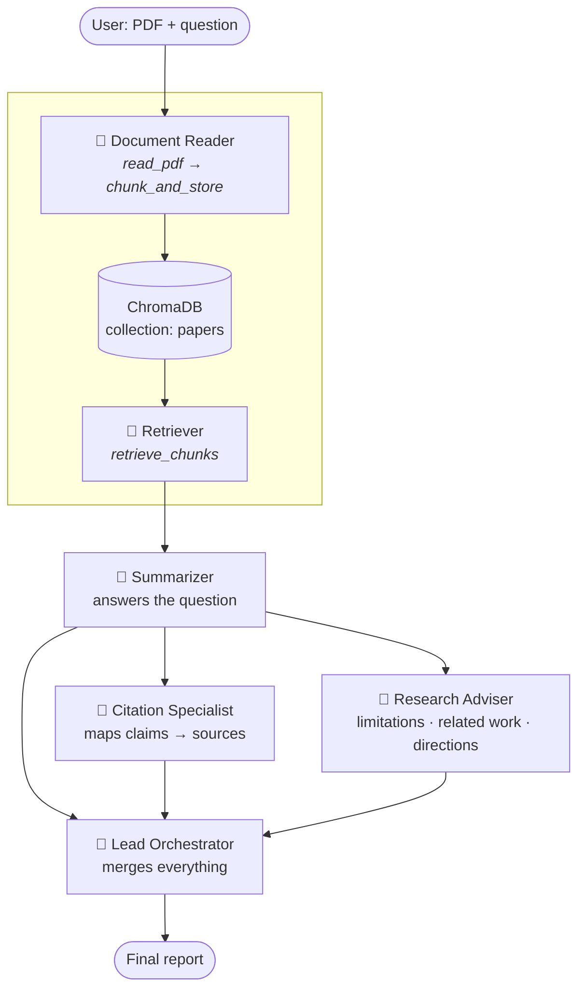

<div align="center">

# 📚 AI Research Assistant

**A multi-agent system that reads a research paper, answers your question about it with citations, and gives research advice, built with CrewAI, ChromaDB and OpenAI.**


</div>

---

## Table of Contents

- [Overview](#overview)
- [How It Works](#how-it-works)
- [The Agents](#the-agents)
- [The Task Pipeline](#the-task-pipeline)
- [Retrieval Layer (RAG)](#retrieval-layer-rag)
- [Project Structure](#project-structure)
- [Installation](#installation)
- [Configuration](#configuration)
- [Usage](#usage)
- [Customisation](#customisation)
- [Known Limitations](#known-limitations)
- [Troubleshooting](#troubleshooting)
- [License](#license)

---

## Overview

Give the assistant a PDF and a question. A team of six AI agents then works through the paper and returns one final report that includes:

1. **An answer** to your question, based on the most relevant passages from the paper.
2. **Citations** linking each claim in the answer to the part of the paper it came from.
3. **Research advice**: the paper's limitations, 3–5 related papers worth reading, and 2–3 ideas for future research.

The system uses **retrieval-augmented generation (RAG)**. The paper is split into chunks, turned into embeddings and stored in a local **ChromaDB** database. The agents then answer only from the passages that best match your question, not from the whole document at once.

## How It Works



The crew runs **sequentially** (`Process.sequential`). Each task receives the outputs of the tasks listed in its `context`, which is how results pass from one agent to the next.

## The Agents

Defined in [`agents.py`](agents.py).

| Agent | Role | Tools | Delegation |
|---|---|---|---|
| **Document Reader** | Extracts the PDF text and prepares it for search | `read_pdf`, `chunk_and_store` | — |
| **Retriever** | Finds the passages most relevant to the question | `retrieve_chunks` | — |
| **Summarizer** | Writes a clear answer that sticks to the retrieved passages | — | — |
| **Citation Specialist** | Links each claim to its place in the source document | — | ✗ |
| **Research Adviser** | Assesses limitations, suggests related work and future directions | — | ✗ |
| **Lead Orchestrator** | Coordinates the team and puts together the final report | — | ✓ |

The Lead Orchestrator is the only agent allowed to hand work back to the others (`allow_delegation=True`), for example to fill a gap before writing the final report.

## The Task Pipeline

Defined in [`tasks.py`](tasks.py) and connected in [`crew.py`](crew.py). Values in `{curly_braces}` are filled in from the inputs passed to `crew.kickoff()`.

| # | Task | Agent | Receives output from | Produces |
|---|---|---|---|---|
| 1 | `ingest_task` | Document Reader | — | Confirmation that the paper at `{file_path}` was chunked and stored as `{paper_id}` |
| 2 | `retrieve_task` | Retriever | 1 | The passages most relevant to `{question}` |
| 3 | `summarize_task` | Summarizer | 2 | An answer to `{question}` based on those passages |
| 4 | `citation_task` | Citation Specialist | 3 | A list linking each claim to its source location |
| 5 | `research_adviser_task` | Research Adviser | 3 | Report with **Limitations**, **Related Papers**, **Future Research Directions** |
| 6 | `lead_orchestrator_task` | Lead Orchestrator | 3, 4, 5 | The final combined report |

## Retrieval Layer (RAG)

Implemented in [`tools/`](tools/) as CrewAI `@tool` functions.

### PDF extraction ([`tools/pdf_tools.py`](tools/pdf_tools.py))

`read_pdf(file_path)` uses **PyMuPDF** (`fitz`) to open the PDF and join the text of every page into one string.

### Chunking and storage ([`tools/vector_tools.py`](tools/vector_tools.py))

| Setting | Value |
|---|---|
| Vector store | ChromaDB `PersistentClient`, saved to `./chroma_db` |
| Collection | `papers` |
| Embedding model | `all-MiniLM-L6-v2` (Sentence Transformers, runs locally) |
| Chunk size | 500 words |
| Chunk overlap | 50 words (stride of 450) |
| Chunk ID format | `{paper_id}_chunk_{i}` |
| Metadata | `{"paper_id": ...}` on every chunk |

- **`chunk_and_store(text, paper_id)`** splits the text into overlapping word windows and adds them to the collection.
- **`retrieve_chunks(query, n_results=5)`** runs a semantic similarity search and returns the top matches, separated by `---`.

The embedding model runs on your own machine, so only the agents' reasoning steps call the OpenAI API. Embeddings don't.

## Project Structure

```
AI-research-assistant/
├── main.py              # entry point: sets inputs and runs the crew
├── crew.py              # builds the Crew (agents + tasks, sequential)
├── agents.py            # the six agent definitions
├── tasks.py             # the six task definitions and their context links
├── tools/
│   ├── pdf_tools.py     # read_pdf: PyMuPDF text extraction
│   └── vector_tools.py  # chunk_and_store / retrieve_chunks: ChromaDB RAG
├── chroma_db/           # persistent vector store (created on first run)
├── sample_paper.pdf     # input paper used by main.py
├── test_key.py          # checks that your OpenAI API key works
├── Test_pdf.py          # checks that PDF extraction works
└── .gitignore
```

## Installation

**Requirements:** Python 3.10+ and an OpenAI API key.

```bash
git clone https://github.com/Navid-A-08/AI-research-assistant.git
cd AI-research-assistant

python -m venv venv
source venv/bin/activate          # Windows: venv\Scripts\activate

pip install crewai chromadb sentence-transformers pymupdf python-dotenv openai
```

> [!NOTE]
> The first run downloads the `all-MiniLM-L6-v2` embedding model (about 90 MB) from Hugging Face. After that it is cached.

## Configuration

Create a `.env` file in the project root. It is gitignored, so it won't be committed.

```env
OPENAI_API_KEY=sk-...
```

CrewAI agents use OpenAI by default. To use a different model, set `OPENAI_MODEL_NAME` in `.env` or pass `llm=...` to each `Agent` in `agents.py`.

Check the key and the PDF reader before a full run:

```bash
python test_key.py     # should print a one-sentence greeting from gpt-4o-mini
python Test_pdf.py     # should print the first 500 characters of sample_paper.pdf
```

## Usage

1. Put your paper in the project root as `sample_paper.pdf`, or change the path in `main.py`.
2. Edit the inputs in [`main.py`](main.py):

   ```python
   result = crew.kickoff(inputs={
       "file_path": "sample_paper.pdf",
       "paper_id": "paper_001",
       "question": "What is the main contribution of this paper?"
   })
   ```

3. Run the crew:

   ```bash
   python main.py
   ```

Because every agent has `verbose=True`, you'll see each agent's reasoning and tool calls as it works. The final report is printed under `FINAL RESULT:`.

### Example questions

- *What is the main contribution of this paper?*
- *What dataset and evaluation metrics were used?*
- *How does the proposed method compare to prior work?*
- *What assumptions does the method rely on?*

## Customisation

| Change | Where |
|---|---|
| Chunk size or overlap | `chunk_text(chunk_size=..., overlap=...)` in `tools/vector_tools.py` |
| Number of retrieved passages | `n_results` default in `retrieve_chunks` |
| Embedding model | `model_name` in `SentenceTransformerEmbeddingFunction` |
| Database location | `PersistentClient(path=...)` |
| Agent personas or goals | `role`, `goal`, `backstory` in `agents.py` |
| Report format | `description` / `expected_output` in `tasks.py` |
| Add or remove a step | Add or remove it in both the `agents` and `tasks` lists in `crew.py` |

## Known Limitations

- **Citations are approximate.** `read_pdf` joins all pages without page markers, and chunks only carry a `paper_id`. The Citation Specialist has no tools of its own, so page and section numbers are inferred from the text, not read from the PDF.
- **Related-paper suggestions aren't checked.** The Research Adviser has no search tool and suggests papers from the model's own knowledge. Verify every reference before relying on it.
- **Retrieval searches every stored paper.** `retrieve_chunks` doesn't filter by `paper_id`, so once several papers are stored, passages from other papers can be returned.
- **Re-ingesting doesn't replace old chunks.** Chunk IDs are fixed per `paper_id`, so running again with the same ID doesn't overwrite what's stored. Use a new `paper_id` or delete `chroma_db/` to start fresh.
- **Text only.** Figures, tables and scanned (image-only) PDFs aren't extracted.

## Troubleshooting

| Symptom | Cause / fix |
|---|---|
| `AuthenticationError` / missing API key | `.env` is missing or not in the project root. Run `python test_key.py` to check. |
| `fitz` import error | Install **`pymupdf`**, not the unrelated `fitz` package. If both are installed, run `pip uninstall fitz` first. |
| Empty or garbled text from `Test_pdf.py` | The PDF is scanned or image-only. Run it through OCR first. |
| Answers mention the wrong paper | Chunks from earlier runs are still stored. Delete `chroma_db/` or use a unique `paper_id`. |
| Slow first run | The embedding model is downloading. Later runs use the cache. |
| `ModuleNotFoundError: tools` | Run scripts from the project root. |

## License

This project is licensed under the [MIT License](LICENSE).
